#MZ-UCA CLOUD ENGINEERING

##Linux Workspace
-Create a basic Cloud Engineering workspace using the Linux terminal
-mkdir cloud-engineering-lab
-cd cloud-engineering-lab
-pwd
-mkdir linux networking scripts terraform documentation
-touch documentation/README.md
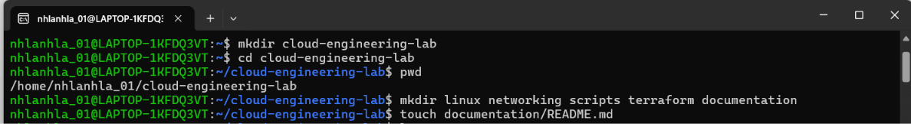
##Understanding Your System
Inspect your operating system, system resources, and running processes:
-uname -a && whoami && date
-df -h && free -h
-ps aux
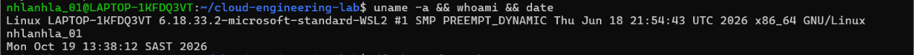
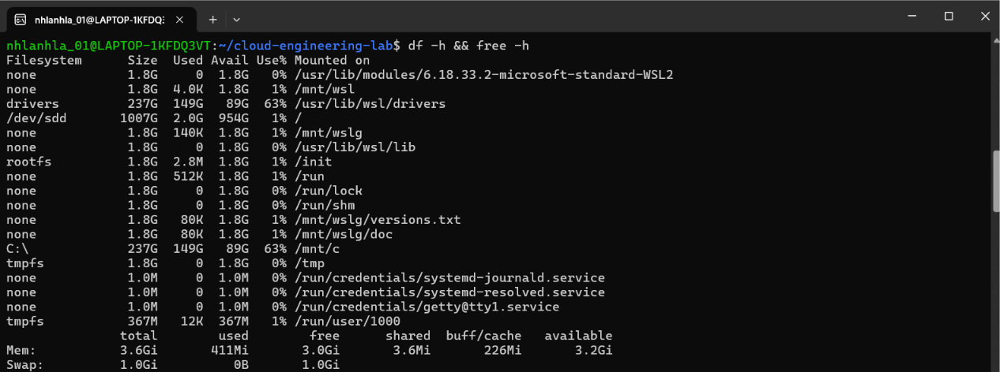
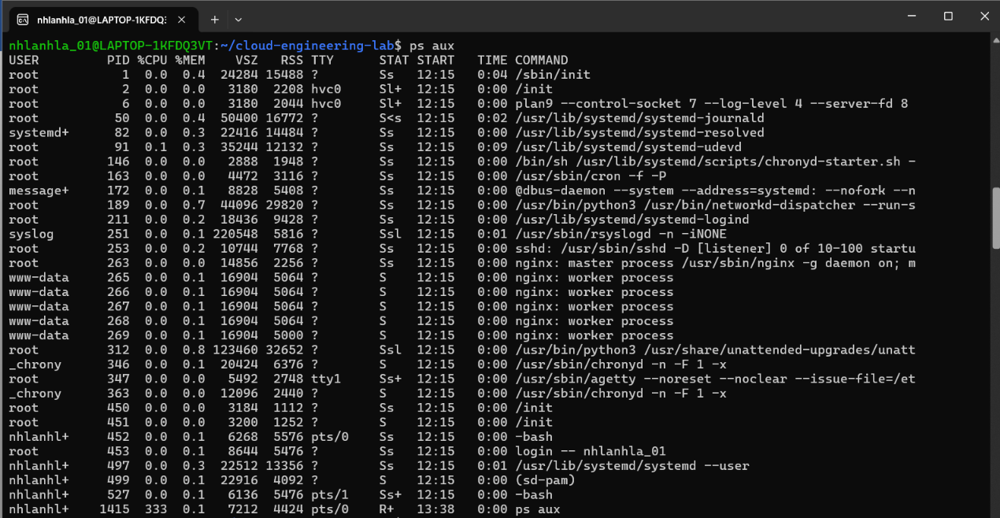
##File Management
Manage application logs and understand output redirection:
touch application.log
echo "Application started" > application.log
echo "Application listening on port 8080" >> application.log
cat application.log
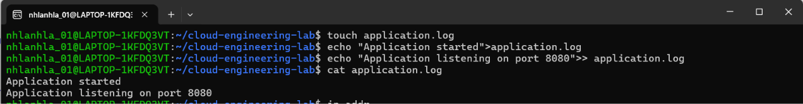
##Networking
Check network settings, routing, and test DNS/connectivity:
-ip addr
-ip route
-ping 8.8.8.8
-ping google.com
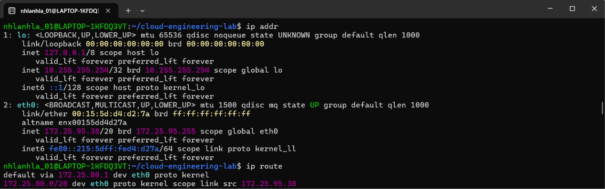
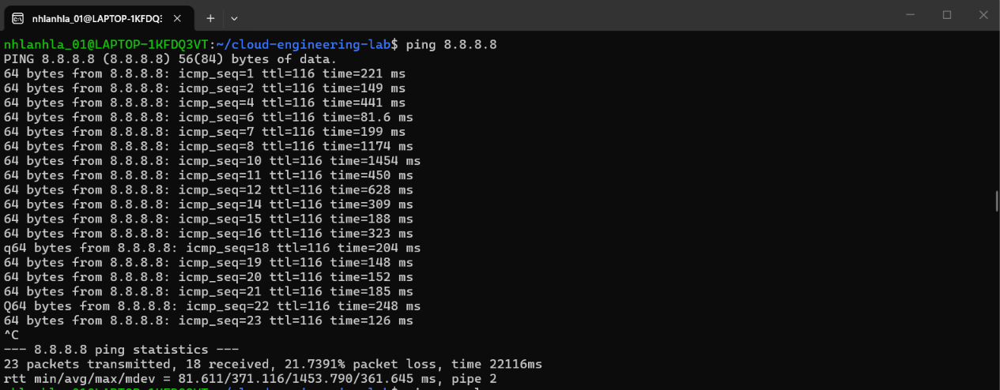
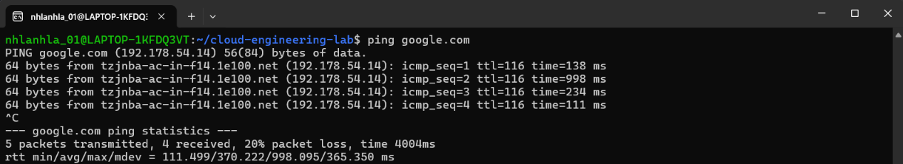
##Services
Inspect background services on systemd-based Linux systems:
-systemctl status ssh
-systemctl --type=service
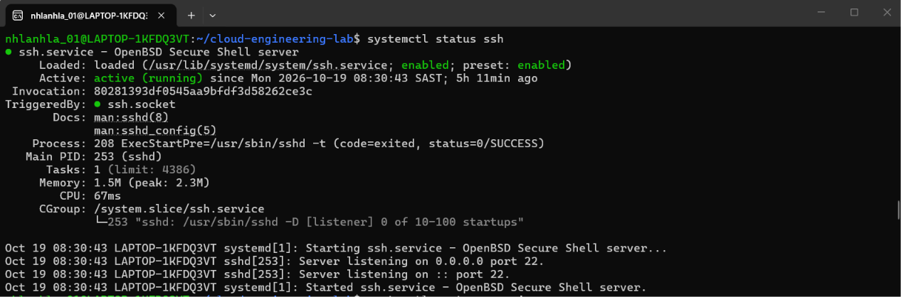
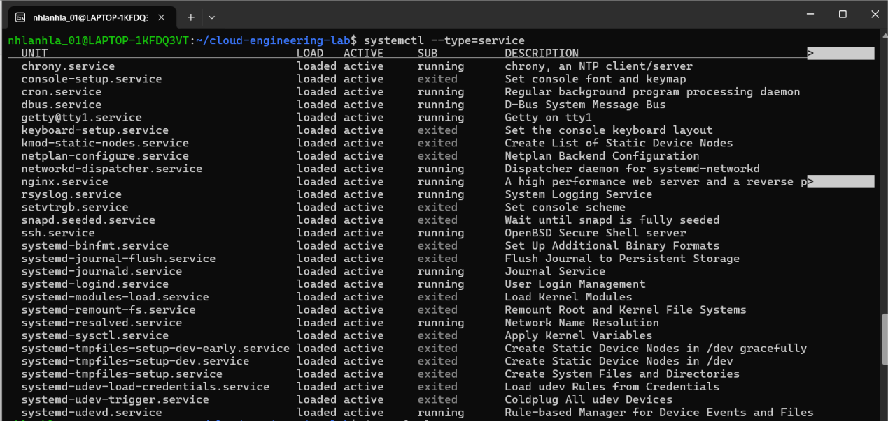
##Log Investigation
Investigate system logs before panicking or restarting servers:
-journalctl -n 20
-journalctl -f
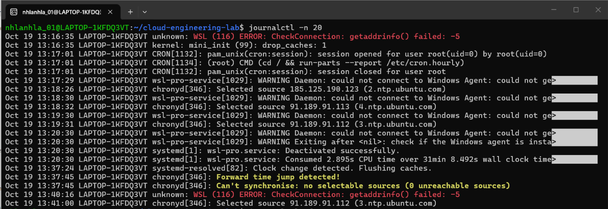
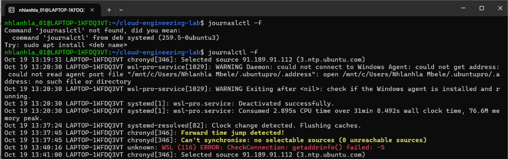
##Basic Bash Script
Create an automation script (system-check.sh):
#!/bin/bash
echo "Cloud Engineering System Check"
whoami; pwd; uname -a; df -h; free -h
-chmod +x system-check.sh && ./system-check.sh
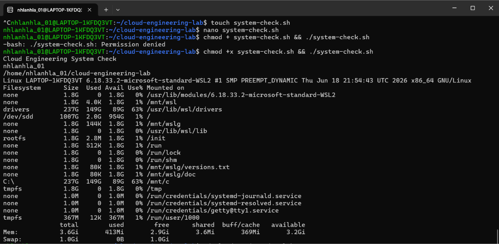
